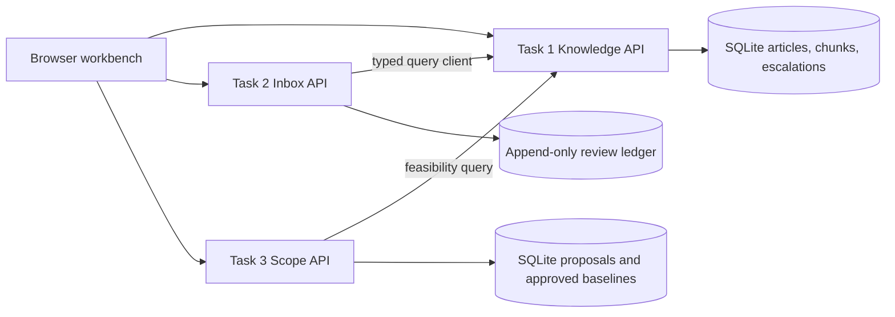

# DESIGN

## Problem

Small software businesses lose time across three linked jobs: finding current product answers, replying to customer email, and converting client conversations into work that can be estimated. If those jobs remain disconnected, staff repeat research, make unsupported promises, and miss scope changes. The design makes product knowledge a shared service and keeps consequential replies and proposals under human control.

## Architecture

Task 1 is the source of product evidence. It parses sitemap URL sets and indexes, checks robots.txt, processes a bounded page batch, follows same-domain Solution Center links from category pages to article pages, retries transient failures, checkpoints per URL/link scan and persists a sitemap cursor in SQLite. Repeated bounded runs resume at the next sitemap entry and prioritize unindexed article links; the optional daily worker continues batches until a complete pass or a failure is reported. Sitemap `lastmod` avoids refetching unchanged pages; content hashing avoids duplicate chunks. Removed sources are deactivated after a successful full traversal. Retrieval is keyword-based offline and optionally hybrid with Voyage vectors when configured. Procedural questions require article-level evidence, not a category/folder snippet. Answers cite indexed evidence and abstain when evidence is missing or does not match the requested feature context. Unanswered questions create an idempotent open escalation; a reviewed answer becomes a separately identified searchable record. An optional daily worker can be enabled with `ENABLE_DAILY_INGESTION=true`.

Task 2 is strict TypeScript. It classifies into eight categories, calls Task 1 with a timeout, and will not draft when evidence is missing or the service fails. The review API records sent/rejected outcomes in an append-only JSONL ledger. “Unchanged” means normalized final text exactly equals normalized generated text and the reviewer marks quality checks passed. A category becomes eligible only after 20 qualifying outcomes; refunds, complaints, quotes, and project requests are never autonomy-eligible. Delivery is simulated, not connected to an email provider.

Task 3 extracts explicit request passages, assigns stable topic IDs, preserves each source quote, flags vague items, and queries Task 1 for feasibility. Estimates are low/likely/high planning ranges, not model-derived commitments. Proposals persist as pending. A reviewer action records an approved version, and only that version becomes the comparison baseline for later transcripts. The diff reports additions, removals, and modifications. Three included meeting files are synthetic development scenarios; they were not role-played or recorded with a friend.

## Model and storage choices

SQLite was chosen to keep the capstone reproducible without external infrastructure. Task 1 stores optional Voyage vectors in SQLite and combines cosine similarity with keyword overlap. The offline path remains keyword-based. Claude Messages adapters cover grounded answers, image descriptions, inbox drafts, and transcript extraction when `ANTHROPIC_API_KEY` and `ANTHROPIC_MODEL` are set. No provider call, model version comparison, token cost, or Claude quality result has been measured in this workspace. The configured model IDs must be recorded and evaluated before deployment.

## Human control and failure behavior

Knowledge abstentions are explicit and create review tasks. Inbox replies are drafts; missing knowledge, model errors, and API errors do not produce customer-facing text. Scope output remains pending until a named reviewer approves it. The browser displays service errors instead of treating empty responses as success. Local services are unauthenticated and bind to loopback; this is not a production deployment pattern.

## Deliberately deferred

The vision and embedding adapters are optional and have not been run because provider credentials are not configured. No live help-center crawl has been completed. There is no distributed crawl concurrency, authentication, external email delivery, pricing calculator, full agent orchestration, human reviewer identity, or verified real-client transcript. Long transcripts are split with overlap, but merging remains deterministic and needs real transcript validation. Crawler batch size and delay are configurable; run small batches and inspect results before a full crawl.

## Next steps

1. Run a polite crawl against the source site and inspect failure and removal reports.
2. Add vision/OCR and hybrid retrieval, then evaluate against screenshot-dependent questions.
3. Collect consented role-play transcripts and realistic inbox labels; replace synthetic fixtures.
4. Run at least 20-30 cases per Claude model decision, recording model ID, quality, latency, token cost, retries, and safety failures.
5. Add authentication, a scheduled ingestion worker, durable structured feedback, and a real approval/delivery integration before any autonomous send.

### `EVALS.md`
- 20+ test cases per task  
- Cost/speed comparisons  

### `AI_LOG.md`
- 5 useful prompts  
- 1 rejected AI answer  

---

